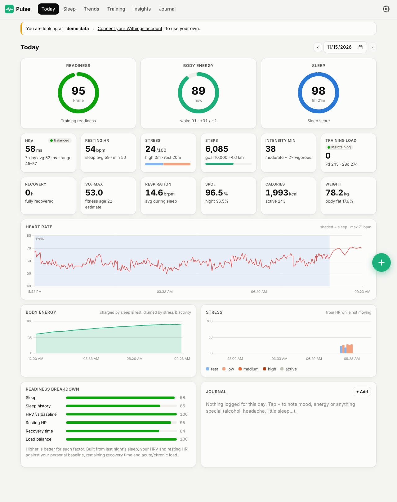
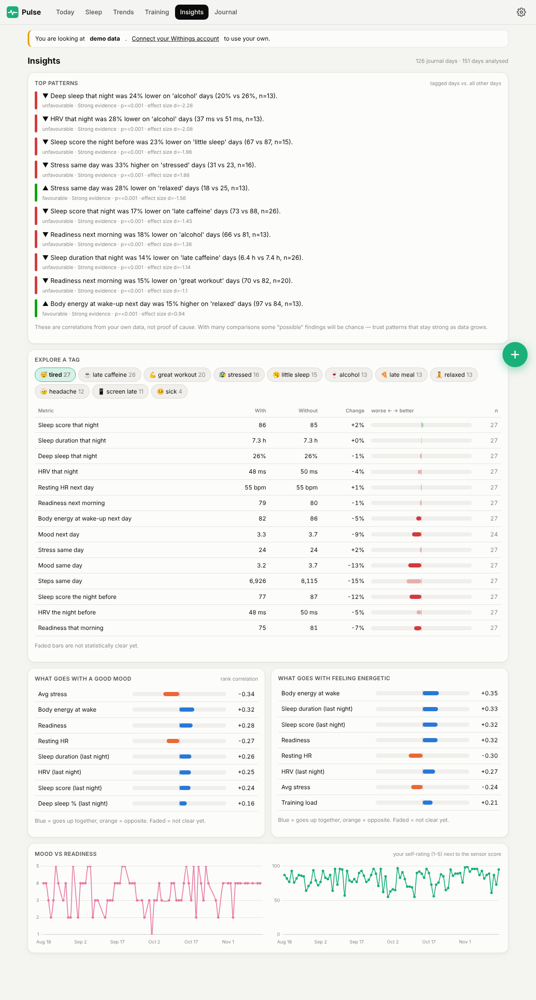
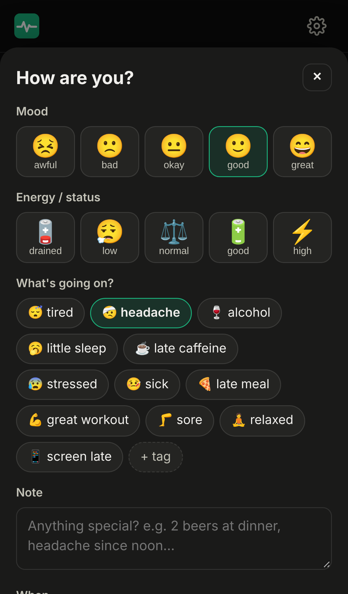

# Pulse — self-hosted health analytics for Withings

Pulse pulls your **Withings ScanWatch 2** data (heart rate, HRV, sleep stages, breathing, SpO₂,
steps, workouts, weight…) into a local SQLite database and computes **Garmin-style metrics**
from the sensor data. It also has a **one-tap journal** for mood, energy and tags (*tired,
headache, alcohol, little sleep…*), and it **finds patterns** between what you log and what
the sensors measure.



| Insights | Quick log (phone, dark mode) |
|---|---|
|  |  |

## What you get

| Metric | How it's computed (all locally, see `app/metrics.py`) |
|---|---|
| **Readiness** (0–100) | Weighted mix of last night's sleep score, 3-night sleep history, HRV vs. your baseline, resting HR vs. baseline, remaining recovery time, and acute/chronic load balance |
| **Body Energy** (5–100) | A simulated battery. Sleep charges it (deep > light > REM, scaled by how well your HRV recovered). Calm rest charges it slightly. Stress and activity drain it. You get an intraday curve plus charged/drained totals |
| **Stress** (0–100) | How far your heart rate is above resting while you're awake and not moving. Shown per sample and as rest/low/medium/high minutes |
| **HRV status** | Nightly mean RMSSD. The 7-day average is compared with your personal baseline range → Balanced / Unbalanced / Low |
| **Resting HR** | Lowest 30-minute rolling average of the day, including the night before |
| **Sleep score** | Duration vs. target, deep %, REM %, efficiency and restfulness. The Withings score is shown next to it |
| **Training load** | Banister TRIMP from HR. Acute (7d) and chronic (28d) EWMA, their ratio, and a status (Productive, Maintaining, Overreaching, Detraining…) |
| **Recovery time** | Grows with load. Good sleep makes it shrink faster |
| **HR zones** | Time in zones 1–5 (% of max HR) per day, per week and per workout |
| **Body signals** (early warning) | Last night's resting HR, HRV, breathing rate, skin temperature and SpO₂ against your own 28-day baseline (robust z-scores). Two or more signals off together → *watch*, three → *alert* |
| **Sleep regularity** | Bedtime and wake-time variability over 7 nights (0–100 score), social jetlag (free-day vs. work-day sleep midpoint) and rolling 7-night sleep debt against your target |
| **VO₂max / fitness age** | Withings Cardio Fitness if your watch reports it, otherwise the Uth estimate (15.3 × HRmax/HRrest) |
| Plus | Hypnogram, sleeping HR and HRV curves, respiration, SpO₂, snoring, breathing disturbances, steps, calories, weight/body fat, trends over 30–365 days |

### Journal and insights
- Tap **+** anywhere (or open `/log` / the home-screen shortcut). Pick a mood (1–5), an energy level (1–5), any tags, and add an optional note. Every field is optional, so one tap on a tag is a valid entry.
- Add your own tags at any time; new tags become quick-pick chips.
- Entries made before 04:00 count toward the previous day, so late drinks land on the right evening.
- **Insights** compares every tag's days with all other days on 14 metrics: the night before, the same day, and the night/morning after. It uses Welch's t-test and Cohen's d and writes the results in plain language, e.g. *"HRV that night was 27% lower on 'alcohol' days (37 ms vs 51 ms, n=25)"*. It also ranks which sensor metrics correlate with your mood and felt energy (Spearman).

## Quick start

```bash
cp .env.example .env        # fill in the values (see below)
docker compose up -d --build
# open http://localhost:8000
```

No watch yet? Go to **Settings → Load demo data** to get 5 months of realistic synthetic data. It includes hidden cause-and-effect patterns that the Insights page will find.

Without Docker: `pip install -r requirements.txt && uvicorn app.main:app --port 8000`.

### Connect Withings
1. Create a free app at <https://developer.withings.com/dashboard/> (choose "Public API integration").
2. Set its **callback URL** to `${PUBLIC_URL}/api/withings/callback`, e.g. `https://health.example.com/api/withings/callback`.
3. Copy the client id and secret into `.env` and restart.
4. **Settings → Connect Withings**. The first sync backfills `HISTORY_DAYS` (default 90). This takes a few minutes because Withings rate-limits requests. After that the app syncs every `SYNC_INTERVAL_MIN`.
5. Optional: put the app behind HTTPS (Caddy, Traefik, Cloudflare Tunnel…) and set `WITHINGS_NOTIFY=true`. Withings will then push a notification each time the watch syncs, so new data shows up within a minute.

**Watch tips for best data:** turn on *continuous heart rate* and *SpO₂/overnight* tracking in the Withings app. Start workouts on the watch so you get high-frequency HR. Sync the watch to the Withings app regularly.

## Honest limitations
- **Withings doesn't expose raw sensor streams** (raw PPG or accelerometer) through its public API. Pulse works with the highest-resolution data the API offers: intraday HR (roughly every 10 min, about 1 s during workouts), minute-level sleep HR, 5-minute overnight RMSSD/SDNN, sleep stages, breathing rate, SpO₂, steps and temperature. Garmin computes some metrics (e.g. stress) from daytime HRV, which Withings doesn't provide, so Pulse's stress score is HR-based.
- All scores are **estimates for spotting trends**, not medical values. Set your real max HR in Settings if you know it; HR zones, load and VO₂max depend on it.
- Insights are correlations, not proof. Expect useful patterns after about 3–6 weeks of regular logging.

## Privacy and data
Everything stays in `data/health.db` (SQLite) on your server. The only outbound calls go to the Withings API. Back up the `data/` folder and you have everything. CSV exports of daily metrics and the journal are in Settings. Set `APP_PASSWORD` before exposing the app.

## Development
```bash
pip install -r requirements.txt pytest
pytest                      # metric/statistics unit tests, sync parsing against mocked Withings payloads, API tests
python -m app.demo 150      # regenerate demo data
```
Layout: `app/withings.py` (OAuth + API), `app/sync.py` (raw data import), `app/metrics.py`
(derived metrics), `app/insights.py` (journal + pattern statistics), `app/main.py` (FastAPI),
`static/` (vanilla JS single-page app + Chart.js, installable as a PWA).
